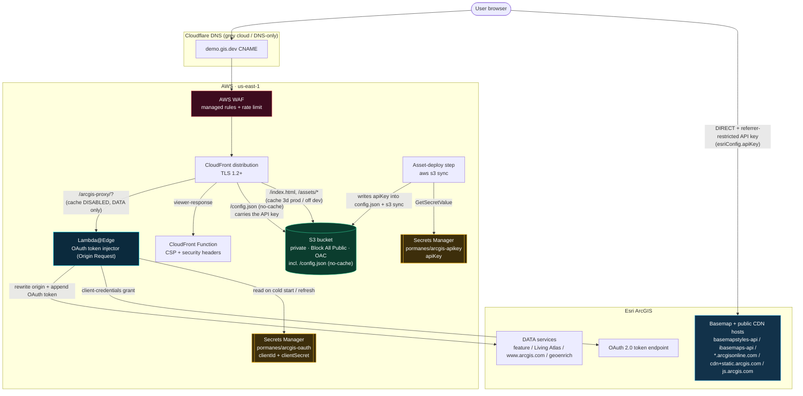
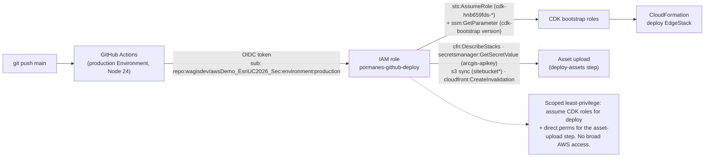

# Infrastructure Diagram

## System architecture

Dual-auth (see ADR-0009): basemaps + public CDN are called **directly** with a
referrer-restricted API key; **data** is proxied through Lambda@Edge with an OAuth
token.



## Token lifecycle at the edge

```mermaid
sequenceDiagram
    participant Tiles as Parallel tile requests
    participant Edge as Lambda@Edge (global cache)
    participant SM as Secrets Manager
    participant OAuth as ArcGIS OAuth

    Tiles->>Edge: request 1 (cache empty / stale)
    Tiles->>Edge: request 2..N (concurrent)
    Note over Edge: Promise lock — one refresh shared
    Edge->>SM: GetSecretValue (cold start / refresh only)
    SM-->>Edge: clientId + clientSecret
    Edge->>OAuth: client_credentials grant (2h token)
    OAuth-->>Edge: access_token + expires_in
    Note over Edge: cache token; stale when now+5min >= expiry
    Edge-->>Tiles: forward each request to Esri + token
```

## CI/CD (GitHub OIDC, least privilege)

Runs on Node 24 runners in the GitHub `production` Environment. OIDC subject is
scoped to `environment:production` (not the branch ref); the deploy role also
carries scoped perms the asset-upload step runs with directly.


